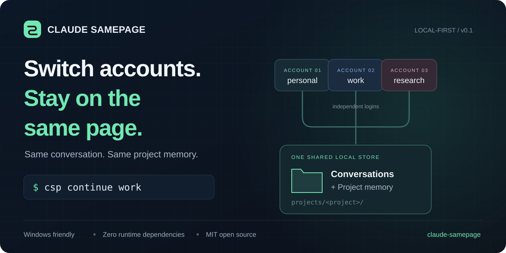
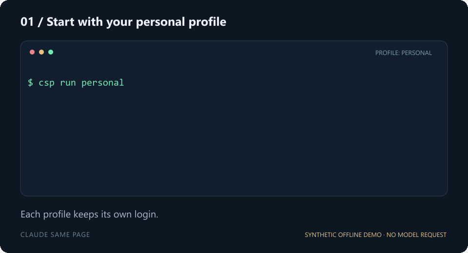

[中文](#中文-readme) | [English](#english-readme) | [中文独立版](README.zh-CN.md) | [English-only](README.en.md)

**中文摘要：** Claude Samepage 让多个 Claude Code 账号保留各自登录，并共享本机的对话记录与项目 memory。关闭当前会话后，使用 `csp continue work` 从另一个账号接着工作。Windows 使用 junction，工具零运行时依赖，不读取或复制凭证。

**English summary:** Claude Samepage keeps Claude Code account logins independent while sharing local conversations and project memory. Close the current session, then use `csp continue work` to pick up from another profile. Windows-friendly, zero runtime dependencies, and no credential reads or copies.

# 中文 README

<p align="center"></p>

<p align="center"><a href="README.en.md">English</a> · <a href="https://github.com/Yu-tao-Li/claude-samepage/actions/workflows/ci.yml">CI</a> · MIT · 零运行时依赖 · Node.js 22+</p>

<h3 align="center">账号换了，对话和项目记忆接着用。</h3>

Claude Code 的独立配置目录可以保留多个登录，但也会把会话分开。**Samepage 把工作接回来**：账号各自登录，共享本地 `projects/`，用一条命令继续原来的工作。

```text
csp run personal          → 开始工作
                          → 关闭当前 Claude 会话
csp continue work         → 在同一工作目录继续最近的会话
```

适合在同一台电脑使用你自己的多个 Claude Code 账号。项目源自实际使用的 Windows 三账号配置，以手动切换、官方登录和本地文件为基础。

## 看一下切换过程

<p align="center"></p>

演示使用虚构数据和离线测试程序，展示的是本地文件共享，不是已登录 Claude 的生成录像。

## 能解决什么

| 需求 | 做法 |
| --- | --- |
| 换账号后继续之前的工作 | 共享本地会话文件，转发 Claude 的 `--continue` / `--resume` |
| 项目 memory 随账号切换保留 | 共用 `projects/<project>/memory/` |
| 登录各自独立 | 为子进程设置各自的 `CLAUDE_CONFIG_DIR`，不复制凭证 |
| Windows 不用管理员权限创建 symlink | 使用目录 junction；macOS/Linux 使用目录 symlink |
| 避免两个入口同时写共享数据 | 同一个共享目录使用同一把写入锁 |
| 安全接入现有配置 | 遇到冲突目录直接停止；`doctor` 不读取凭证内容 |

## 快速开始

先安装 **Node.js 22+** 和 [Claude Code](https://code.claude.com/docs/en/setup)，确认 `claude` 在 PATH 中可用。下面的命令适用于 PowerShell、Bash 和 Zsh。以下命令安装已打包的 GitHub Release，尚未发布到 npm registry。

```sh
npm install -g https://github.com/Yu-tao-Li/claude-samepage/releases/download/v0.1.1/claude-samepage-0.1.1.tgz
csp init
csp add personal
csp add work
csp login personal
csp login work
```

登录交给 Claude 官方 CLI。浏览器打开时分别选择正确的账号。然后进入你的项目目录：

```sh
csp run personal
# 关闭第一个会话，再切换。
csp continue work
```

新账号首次运行可能需要完成初始设置或确认工作目录信任，完成一次即可。`continue` 选择当前工作目录最近的会话；想准确指定某段对话，可以使用 Claude 的 session ID：

```sh
csp resume work
csp resume work YOUR_SESSION_ID
csp run work -- --model sonnet
csp continue work -- --model opus
```

### 固定一个工作目录

```powershell
csp init --workspace "D:\Work\MyProject"
```

设置后从任何目录启动都会进入这个工作目录；没有设置时使用当前目录。子进程退出后，父终端的目录和环境变量保持原样。

### 接入已有账号和历史对话

先关闭使用这些配置的所有 Claude 进程。选定要保留的 `projects/` 作为共享源，再登记账号：

```powershell
csp init --shared-projects "D:\Profiles\personal\projects" --workspace "D:\Work\MyProject"
csp add personal --config "D:\Profiles\personal"
csp add work --config "D:\Profiles\work"
csp doctor
```

第二个配置目录必须没有 `projects/`，或者已经链接到同一个共享源。如果它有独立历史，工具会停止并保留原文件。请先备份并确定迁移策略；工具不会自动合并、删除历史或导入凭证。另一套独立配置可以使用不同的 `CSP_HOME`。再次运行 `init` 不会覆盖已存在的配置。

## 哪些共享，哪些独立

| 共享 | 各自独立 |
| --- | --- |
| `projects/` 中的本地会话文件 | 凭证、账号身份和账号配置 |
| 默认位置的项目 auto memory | 用户 settings、plugins、全局 skills、全局 `CLAUDE.md` |
| 同一工作目录中的项目文件、项目 `CLAUDE.md` 和项目 skills | `history.jsonl` 命令历史与各自缓存 |

Samepage 只链接 `projects/`，只为子进程设置配置目录，直接传递命令参数。登录与模型请求由 Claude 官方 CLI 执行。[实现与数据边界](docs/architecture.md)

若你显式设置了 `autoMemoryDirectory`，Claude 可以使用其他记忆目录，Samepage 不会改写该设置。共享文件不代表所有内容都会进入模型上下文；会话恢复、压缩和 memory 加载仍由 Claude 决定。

**范围是本机 Claude Code 终端会话。** claude.ai 网页对话、云端账号记忆、远程会话和 Claude Desktop 登录不在此工具范围内。它也不构成操作系统权限隔离：启动的 Claude 具有当前用户的文件权限，需要隔离的工作请使用不同的共享目录。

## 命令

| 命令 | 用途 |
| --- | --- |
| `csp init [--workspace DIR] [--shared-projects DIR]` | 初始化，可接入已有共享源 |
| `csp add NAME [--config DIR]` | 创建或登记账号配置 |
| `csp login NAME` | 执行官方 `auth login` |
| `csp use NAME` | 设置默认账号 |
| `csp list` | 列出账号名称和配置目录 |
| `csp run [NAME] -- [ARGS]` | 启动并原样转发参数 |
| `csp continue [NAME] -- [ARGS]` | 继续当前工作目录最近的对话 |
| `csp resume [NAME] [SESSION] -- [ARGS]` | 打开历史选择器或按 ID 恢复 |
| `csp doctor [--json]` | 检查链接、可执行文件和锁 |
| `csp unlock --stale` | 确认记录的进程已经退出后移除残留锁 |

`csp` 和 `claude-samepage` 是同一个入口。`CSP_CLAUDE_BIN` 可以指定原生 Claude 可执行文件。Windows 下会把官方 npm shim 解析为实际 `claude.exe`，不会执行任意 `.cmd` 或 `.ps1` 包装脚本。

## 验证范围

| 层面 | 状态 |
| --- | --- |
| 原始 Windows 方法 | 在来源机器检查了三个独立配置目录及共享链接 |
| v0.1.0 本地验证 | Windows 虚构数据测试；检查了 Claude 2.1.296 实际可执行文件解析 |
| CI | Windows/Linux/macOS × Node 22/24，测试文件共享、启动、文件保护和锁 |
| 真实登录后的生成 | 不属于自动测试范围，测试不需要消耗模型请求 |

[官方多账号文档](https://code.claude.com/docs/en/authentication#log-in-with-multiple-accounts)支持 claude.ai 账号使用不同的 `CLAUDE_CONFIG_DIR`。不使用 API key 的 Claude Console 登录有官方注明的隔离例外，本工具的工作流使用 claude.ai 账号。存在可能覆盖所选账号的 API key、OAuth token 或第三方路由环境变量时，启动会停止，只显示变量名。

**关闭旧会话再切换。** 锁只覆盖 Samepage 启动的进程；直接运行 `claude`、旧 alias、编辑器会话和其他工具可以绕过它。异常退出后，`unlock --stale` 会拒绝仍存活的进程、其他主机的锁和没有完整记录子进程 PID 的中断启动。[故障排查](docs/troubleshooting.md)

## 保持轻量

- 零运行时依赖，源码使用可读的 ESM。
- 工具自身不复制凭证，不联网，不收集遥测。
- 手动切换账号，不承诺订阅额度变化。
- 不修改 shell profile、Claude settings 或会话内容。

## 参与项目

```sh
git clone https://github.com/Yu-tao-Li/claude-samepage.git
cd claude-samepage
npm test
npm run audit:public
```

反馈时提供操作系统、Node/Claude 版本和去除私人路径的 `csp doctor` 输出。请不要附上凭证或真实对话文件。[参与贡献](CONTRIBUTING.md) · [安全说明](SECURITY.md) · [版本记录](CHANGELOG.md)

如果帮你保住了工作节奏，欢迎点一个 **Star**。不同系统的兼容性反馈也很有价值。

MIT 协议。独立社区项目，与 Anthropic 无隶属关系；Claude 和 Claude Code 为 Anthropic 的商标。

---

# English README

<p align="center">
  
</p>

<p align="center">
  <a href="https://github.com/Yu-tao-Li/claude-samepage/actions/workflows/ci.yml"></a>
  <a href="LICENSE"></a>
  
  
  <a href="README.zh-CN.md"></a>
</p>

<h3 align="center">Different account. Same conversation. Same project memory.</h3>

Claude Code profiles keep logins apart. They also keep your sessions apart.
**Samepage reconnects the work:** separate account directories, one shared `projects/` directory, and a short command to pick up where you left off.

```text
csp run personal          → work on your project
                         → close that Claude session
csp continue work        → continue the latest session in the same workspace
```

**For your own Claude Code accounts on one machine.** Manual switching, official Claude login, local files. Born from a working three-account Windows setup.

## See the handoff

<p align="center"></p>

*The demo uses synthetic data and an offline fixture. It shows Samepage's local file sharing; it is not a recording of authenticated Claude generation.*

## Why Samepage?

| You want… | Samepage does… |
| --- | --- |
| A different account, without explaining everything again | Launches that profile with the shared transcript store; passes Claude's `--continue` / `--resume` |
| Project memory that follows the conversation | Shares the same `projects/<project>/memory/` files |
| Independent sign-ins | Sets `CLAUDE_CONFIG_DIR` for the child process; never copies credential files |
| A Windows setup that needs no symlink privilege | Uses directory junctions on Windows, directory symlinks on macOS/Linux |
| Safe handoff | One shared writer lock across all Samepage launchers using the same store |
| Confidence before adopting existing profiles | Refuses conflicting directories; `csp doctor` checks links without reading secrets |

## Start in a minute

Requirements: **Node.js 22+** and [Claude Code](https://code.claude.com/docs/en/setup) installed and available on PATH. Commands work in PowerShell, Bash, and Zsh. Install the packaged GitHub Release below; there is no npm-registry release yet.

```sh
npm install -g https://github.com/Yu-tao-Li/claude-samepage/releases/download/v0.1.1/claude-samepage-0.1.1.tgz

csp init
csp add personal
csp add work
csp login personal
csp login work
```

Claude handles both logins. In the browser, select the intended account each time. Then, from your project's directory:

```sh
csp run personal
# Close the first session before switching.
csp continue work
```

If the new profile asks for first-launch setup or workspace trust, complete that once. `continue` selects the latest session in that workspace. For a specific conversation, use its Claude session ID:

```sh
csp resume work
csp resume work YOUR_SESSION_ID
csp run work -- --model sonnet
csp continue work -- --model opus
```

### Always open the same workspace

For a dedicated chat or coding folder, pin it during initialization:

```powershell
csp init --workspace "D:\Work\MyProject"
```

Without `--workspace`, Samepage uses your current directory. With it, every profile starts in the pinned folder. Your parent shell's directory and environment remain unchanged.

### Already have accounts and conversations?

Close all Claude processes that use those profiles. Point Samepage at **the existing `projects/` folder you want to keep**, then register the profiles:

```powershell
csp init --shared-projects "D:\Profiles\personal\projects" --workspace "D:\Work\MyProject"
csp add personal --config "D:\Profiles\personal"
csp add work --config "D:\Profiles\work"
csp doctor
```

The second profile must have **no `projects/` directory**, or already link to that same shared store. If it has independent history, Samepage stops and preserves it. Back it up and choose a migration strategy first. There is no automatic merge, deletion, or credential import.

Use `CSP_HOME` for a second, completely separate Samepage setup. Existing configuration is never overwritten by another `init`.

## How it works

```text
personal/                         work/
├── credentials & account state   ├── credentials & account state
├── settings & plugins            ├── settings & plugins
└── projects/ ────────┐   ┌─────── projects/
                     ▼   ▼
                shared/projects/
                └── <project>/
                    ├── <session>.jsonl
                    └── memory/
                        └── MEMORY.md
```

Samepage changes only the child process's `CLAUDE_CONFIG_DIR`, links only `projects/`, and forwards arguments without a shell. The official CLI performs authentication and talks to Anthropic. [Architecture and data boundaries →](docs/architecture.md)

| Shared | Separate |
| --- | --- |
| Local session transcripts under `projects/` | Credentials, account identity and account configuration |
| Default project auto memory under `projects/` | User settings, plugins, global skills, global `CLAUDE.md` |
| Workspace files, including project `CLAUDE.md` and project skills | `history.jsonl` command history and per-profile caches |

An explicit `autoMemoryDirectory` setting can override Claude's default memory location. Samepage does not rewrite it. Sharing files also does not make every byte enter the model's context: Claude still applies its own resume, compaction, and memory-loading behavior.

**Scope:** local Claude Code terminal sessions. claude.ai chats, account-side memory, remote sessions, and Claude Desktop sign-ins are outside this tool. This is not an OS security boundary between accounts: each launched Claude has your user's filesystem permissions. Use separate stores for work that must remain separate.

## Commands

| Command | Purpose |
| --- | --- |
| `csp init [--workspace DIR] [--shared-projects DIR]` | Create a setup; optionally adopt an existing store |
| `csp add NAME [--config DIR]` | Create or register an isolated profile |
| `csp login NAME` | Run Claude's own `auth login` |
| `csp use NAME` | Set the default profile |
| `csp list` | List profile names and directories |
| `csp run [NAME] -- [ARGS]` | Launch Claude with exact arguments |
| `csp continue [NAME] -- [ARGS]` | Pass `--continue` to Claude |
| `csp resume [NAME] [SESSION] -- [ARGS]` | Open the session picker or resume by ID |
| `csp doctor [--json]` | Check links, executable, and lock presence |
| `csp unlock --stale` | Remove a lock only after its recorded processes are dead |

`csp` and `claude-samepage` are the same executable. `CSP_CLAUDE_BIN` can select an absolute native Claude executable. Windows npm shims are resolved to the official package's native binary; arbitrary `.cmd` / `.ps1` shims are not executed.

## Compatibility and verification

| Layer | Status |
| --- | --- |
| Windows local method | Three independent account directories with shared project links inspected on the origin machine |
| v0.1.0 local verification | Windows fixture tests; installed Claude 2.1.296 executable resolution checked |
| CI | Windows, Linux, macOS × Node 22/24: synthetic sharing, launch, data preservation, and locking tests |
| Real authenticated generation | Not part of the automated suite; no paid model request is required for tests |

The [official multi-account documentation](https://code.claude.com/docs/en/authentication#log-in-with-multiple-accounts) supports separate `CLAUDE_CONFIG_DIR` values for claude.ai accounts. Claude Console sign-ins without an API key have a documented isolation exception. Use claude.ai profiles for this workflow. Account-routing environment variables are rejected before launch so they cannot silently override your selected sign-in.

**Close before switching.** The lock covers Samepage launches only. Direct `claude` commands, old shell aliases, editor sessions, and other tools can bypass it. After a crash, `csp unlock --stale` refuses live processes, foreign-host locks, and interrupted launches whose child PID was not recorded. [Troubleshooting →](docs/troubleshooting.md)

## Small by design

- Zero runtime dependencies. Readable ESM source.
- No credentials copied, no network code, no telemetry in Samepage.
- No automatic account rotation or promises about subscription limits.
- No rewrites of your shell profile, Claude settings, or transcripts.

## Contribute

```sh
git clone https://github.com/Yu-tao-Li/claude-samepage.git
cd claude-samepage
npm test
npm run audit:public
```

Please report your OS, Node and Claude versions, and redacted `csp doctor` output. Never attach credentials or real transcript files. [Contributing](CONTRIBUTING.md) · [Security](SECURITY.md) · [Release notes](CHANGELOG.md)

If this helps you keep your flow, a **Star** helps others find it. Windows/macOS/Linux compatibility reports are especially useful.

MIT licensed. Independent community project; not affiliated with Anthropic. Claude and Claude Code are Anthropic trademarks.
